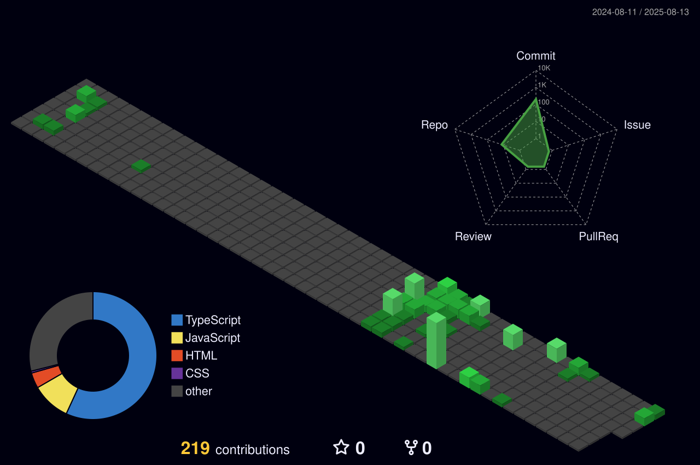

 🔥 Front-End Developer 🔥 

  
|  |  |
|:--:|:--:|

 🛠 &nbsp;Tech Stack 

## 🔵 Principal

## ⚙️ Ferramentas & DevOps

## 📦 Frameworks & Libs

## 🗄️ API & Dados

## 🎨 Estilo & UI

## 🤖 IA

## 🖥️ Backend

## ☁️ Cloud & Infra

## 📱 Mobile

## 🧪 Testes

## ⛓️ Web3 & Blockchain

## 🎨 Design

 
  
&nbsp;

  

